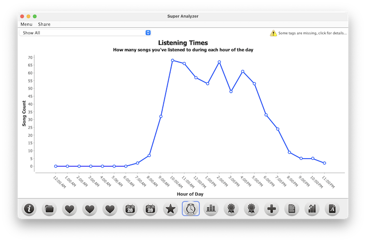
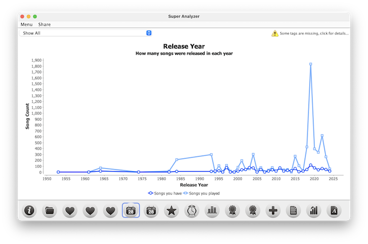
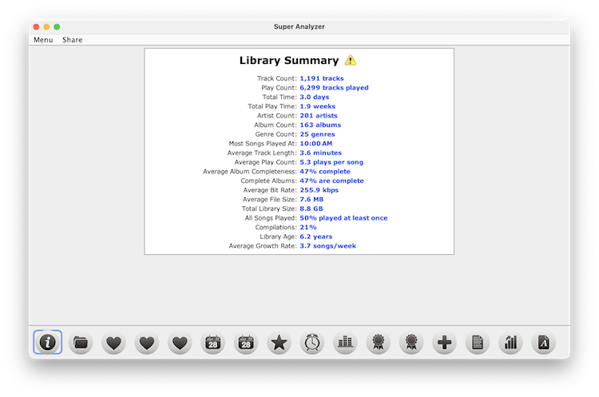

Super Analyzer
==============

Analyzes your Apple Music library and generates a variety of charts about your music collection and listening habits.

## Usage

### Prerequisites

- macOS or Windows/Linux with a desktop environment
- **Java 8 or newer** to run the app
- **Java 8 JDK or newer** (`javac` and `java` on PATH) to build from source

The program was originally written in 2009 for Java 5/6. The current source uses Java 7+ language features (for example, the diamond operator) and compiles cleanly with `--release 8`.

### Export your Apple Music library

1. In the Apple Music app, choose **File → Library → Export Library…**
2. Save the exported XML file (for example, `Library.xml`).

The app can also use a legacy `iTunes Library.xml` if you still have one in your Music/iTunes folder.

### Build and run (VS Code)

1. Install the [Extension Pack for Java](https://marketplace.visualstudio.com/items?itemName=vscjava.vscode-java-pack).
2. Open this folder in VS Code.
3. Run the build task: **Terminal → Run Build Task… → `build-super-analyzer`** (runs `build.sh`).
4. Start the app: **Run and Debug → `Launch Super Analyzer`**.

### Build and run (Terminal)

From the repo root, compile with `build.sh`:

```bash
./build.sh
java -cp 'build/classes:libs/*' net.nosleep.superanalyzer.Main
```

### Build a runnable JAR

`build-jar.sh` does everything `build.sh` does, then packages a fat JAR with bundled dependencies:

```bash
./build-jar.sh
java -jar build/super-analyzer.jar
```

Use `build.sh` for quick development builds. Use `build-jar.sh` when you want a single file you can run or share.

To target Java 8 explicitly when compiling by hand:

```bash
find src -name '*.java' -print0 | xargs -0 javac --release 8 -encoding UTF-8 -d build/classes -cp 'libs/*'
```

### Once launched

- Click **Analyze**, or use the menu to choose your exported `Library.xml` if the app does not find a library automatically.
- Explore tabs for genres, years/decades, play counts, ratings, and more.
- Use **Share** to save the full analysis as PDF or HTML, save a list of albums as PDF, or save the current chart as a PNG image.
- Large libraries can take a minute or two to parse. If you launch from a terminal, progress messages are printed there while the analysis runs.

## Screenshots







## Similar Projects

- [GraphMyTunes](https://github.com/homebysix/GraphMyTunes)

## License

This project is free software, distributed under the GNU General Public License, version 2 or (at your option) any later version. See the license headers in the source files and visit https://www.gnu.org/licenses/old-licenses/gpl-2.0.html for details.
